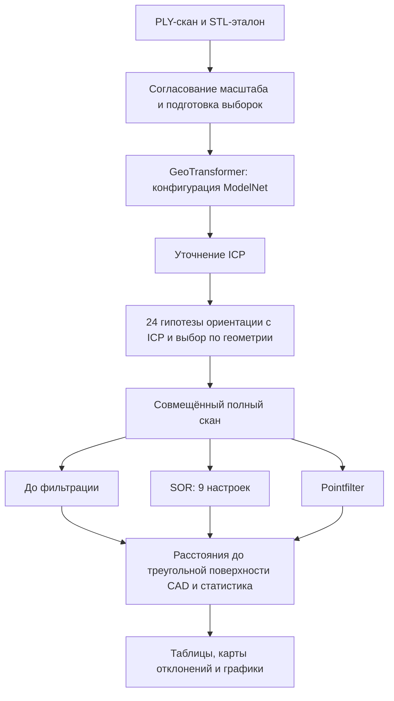
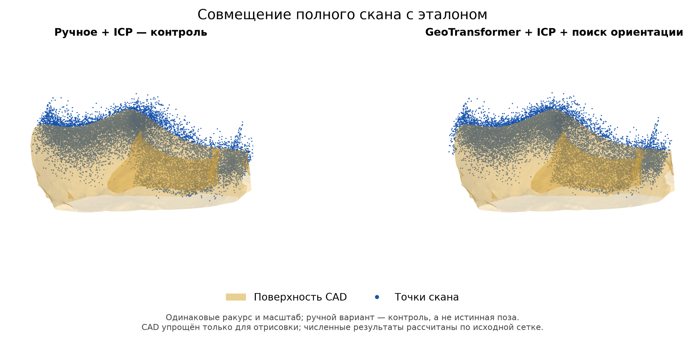
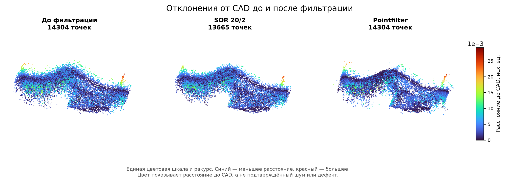

# CAD / Scan Inspection

Экспериментальный стенд на Python для совмещения облака точек со STL-эталоном и сравнения геометрических отклонений до и после SOR / Pointfilter.

**Полный единый запуск проверен 30 октября 2026 года** на паре `shoe.stl` / `shoe_clean.ply`: 14 304 точки скана, 165 591 треугольник эталона. Все шесть вычислительных этапов завершены; Pointfilter обработал все точки без пропусков.

[Краткий PDF-отчёт с блок-схемой, рисунками и статистикой](reports/cad_scan_stand_report_20261030.pdf) · [Подробная инструкция стенда](cad_scan_stand/README.md) · [Численные результаты](cad_scan_stand/observed_results.json)

## Конвейер



Масштаб берётся из сохранённой ручной калибровки. Ручные поворот и перенос не используются нейросетью и при выборе ориентации; сохранённое ручное совмещение с ICP служит отдельным контролем. Итоговая регистрация представляет собой гибрид GeoTransformer, ICP и геометрического поиска.

SOR и Pointfilter обрабатывают одно и то же совмещённое облако независимо. Регистрация после фильтрации не повторяется.

## Результаты на имеющейся паре

Изменения расстояний до CAD относительно облака **до фильтрации**, при одном и том же совмещении:

| Метод | Изменение среднего | Изменение P95 | Изменение стандартного отклонения | Удалено точек |
|---|---:|---:|---:|---:|
| SOR: 20 соседей, std_ratio=2 | -4,52% | -6,80% | -6,95% | 4,47% |
| Pointfilter | -15,12% | -11,89% | -8,26% | 0% |

Отрицательный процент означает уменьшение показателя. Для SOR статистики относятся только к оставшимся точкам. Снижение расстояния до CAD само по себе не подтверждает удаление именно шума или сохранение реальных дефектов.





[Сравнение всех настроек фильтров](figures/20261030/03_filter_metrics.png) · [Распределения расстояний](figures/20261030/04_distance_distribution.png)

## Запуск

Текущая версия использует три уже настроенных окружения:

| Этап | Окружение |
|---|---|
| Загрузка STL/PLY, SOR, расстояния до CAD, отчёт и рисунки | Windows `.venv` с Open3D / NumPy / Matplotlib |
| GeoTransformer, ICP и поиск ориентации | Ubuntu в WSL2, Conda `geotransformer` |
| Pointfilter | Windows `.venv-ai` с PyTorch / CUDA |

В `cad_scan_stand/config.json` укажите `project_dir`: папку с данными, `aligment.npz`, подготовленными `registration_input`, окружениями и локальным репозиторием Pointfilter. По умолчанию это корень репозитория. Пути WSL и имена окружений также задаются в этом файле.

Из корня проекта в PowerShell, используя интерпретатор установленного окружения:

```powershell
.\.venv\Scripts\python.exe .\cad_scan_stand\run_stand.py
```

Программа создаёт новый каталог `stand_runs/run_...` с общим отчётом, таблицами, матрицами, журналами и промежуточными массивами. После завершения экспортируйте рисунки по сохранённым результатам:

```powershell
.\.venv\Scripts\python.exe .\cad_scan_stand\export_figures.py
```

Выводятся PNG 300 dpi и PDF на белом фоне. При экспорте используется общий ракурс и цветовая шкала; поворот камеры для текущего объекта по умолчанию составляет 180° и не изменяет координаты или метрики.

Если окружения и данные находятся в другой папке, задайте соответствующий `project_dir` и запускайте программы интерпретатором `.venv` из этой папки. Подробности подготовки, зависимостей и параметров приведены в [инструкции](cad_scan_stand/README.md).

## Содержимое обновления

| Каталог | Назначение |
|---|---|
| `cad_scan_stand/` | Единый запуск, настройки, вычислительные программы, экспорт рисунков и пример результатов |
| `reports/` | Краткий отчёт для научного руководителя |
| `figures/20261030/` | Четыре финальных рисунка текущего эксперимента |

Сторонние репозитории и веса моделей подключаются из локально установленных GeoTransformer / Pointfilter. Их условия использования определяются собственными лицензиями.

Результаты пока относятся к одному объекту и одному seed. Физическая единица исходного CAD не подтверждена; расстояния приводятся в единицах его координат. Односторонняя метрика расстояний не характеризует полноту покрытия CAD частичным сканом.
